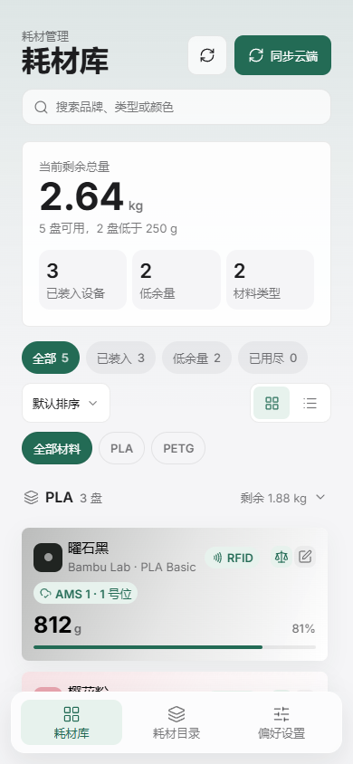
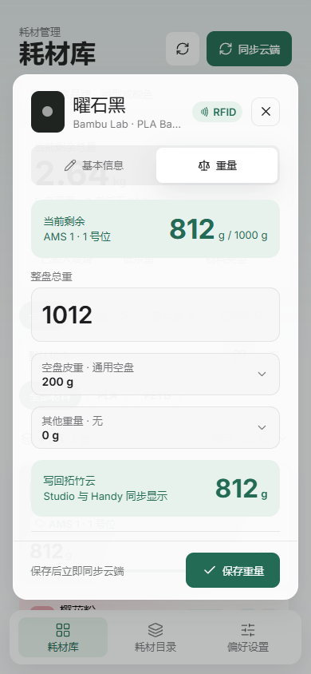

# 余量

> 面向 Bambu Lab（拓竹）用户的耗材称重、余量计算与云端同步工具。

[](https://github.com/Lycus0321/filament-app)
[](https://yuliang.lykkk.fun)
[](https://github.com/Lycus0321/filament-app/releases/tag/android-latest)
[](https://workers.cloudflare.com/)

**当前版本：`1.1.11`　Android：`versionCode 23`**

<p align="center">
  
  
</p>

## 项目简介

拓竹官方对耗材余量的统计依赖 RFID 和估算数据，第三方耗材通常无法自动统计，估算值也可能与实际剩余量产生偏差。

“余量”通过电子秤获取准确重量，自动扣除空盘皮重和其他附加重量，再把计算结果同步回拓竹云端：

```text
整盘总重 - 空盘皮重 - 其他重量 = 耗材剩余净重
```

项目使用一套 Expo 代码同时输出 PWA、Android，并保留 iOS 原生构建能力。Web/PWA 通过 Cloudflare Workers 代理拓竹 API；Android/iOS 直接连接拓竹 API。

> 本项目不是 Bambu Lab 官方产品，使用的是社区维护的非公开接口。接口变化可能导致部分功能失效。

## 功能

### 精准称重

- 输入整盘总重，自动计算剩余净重。
- 支持空盘皮重和其他重量，例如配重环、转接件。
- 总重、皮重和附加重量仅接受整数克重。
- 实时校验空值、负数、超重和总重小于皮重的情况。
- 每个料盘记忆上次使用的皮重和其他重量。
- 支持标记耗材已用尽或从拓竹云端删除。
- API 超时、读取失败和保存失败均有明确提示。

### 耗材库

- 从拓竹云端读取耗材库并显示 RFID、AMS 位置和剩余重量。
- 按 PLA、PETG、ABS、ASA、TPU、PC、PA 和其他材料分组。
- 材料分类支持展开和收起。
- 支持按名称、品牌、型号、颜色、备注和设备搜索。
- 支持全部、已装入、低余量和已用尽筛选。
- 支持默认排序、余量升降序和名称排序。
- 支持卡片与列表视图。
- 已用尽耗材默认隐藏。
- PC、平板和手机使用响应式布局。

### 耗材信息编辑

- 名称、品牌、型号、颜色和备注编辑。
- 品牌、型号、颜色联动选择。
- 官方目录与自定义选项统一管理。
- 常用选项优先显示，其他选项通过“加载更多”查看。
- 支持隐藏不常用选项。
- 隐藏品牌会联动隐藏型号和颜色。
- 新增和编辑使用独立弹窗，列表与表单分离。

### 颜色与皮重管理

- 颜色选择器支持拖拽饱和度和明度面板、色相条和实时预览。
- 支持常用色块与 HEX 精确输入。
- 官方颜色只读，自定义颜色可编辑和删除。
- 空盘皮重和其他重量均按“名称 + 克重”管理。
- 皮重可绑定品牌和型号。
- 称重时自动按“历史选择 → 型号默认 → 品牌和型号 → 品牌 → 型号 → 全局默认”匹配皮重。

### RFID 安全模式

默认情况下，RFID 料盘的原始品牌、型号和颜色保持不变，自定义名称和身份信息写入料盘名称与备注。

偏好设置中可以开启全局“强制修改 RFID 字段”：

- 默认关闭。
- 开启后直接覆盖品牌、型号、颜色和颜色数组。
- 可能与 Bambu Studio、Bambu Handy 或实体标签中的 RFID 数据冲突。

### PWA 与移动端

- PWA 支持安装、独立窗口和自动更新。
- PC 使用顶部导航，手机使用底部导航。
- 适配安全区域和 Android 软键盘。
- 弹层正文可滚动，底部操作区固定。
- Android 返回键优先关闭下拉框和弹层。
- 本地偏好使用 AsyncStorage，凭据使用 SecureStore。

### 数据导入导出

- 通过 JSON 输入框手动导出和导入本地偏好。
- 支持合并导入和完整替换。
- 合并时按 ID 和内容去重。
- JSON 不包含 Bambu Token、Cookie 或账号凭证。
- 本地偏好不自动跨设备同步。

## 技术栈

| 层级 | 技术 |
|---|---|
| 客户端 | Expo、React Native、React Native Web、TypeScript |
| Web/PWA | Service Worker、Web App Manifest、Cloudflare Workers |
| Android/iOS | Expo、Expo SecureStore |
| 云端代理 | Cloudflare Workers、Workers Static Assets、Rate Limiting binding |
| 本地数据 | AsyncStorage、SecureStore |
| 自动化 | GitHub Actions、Playwright |

### API 链路

```text
PWA
  -> Cloudflare Worker /api/*
    -> api.bambulab.cn / api.bambulab.com

Android / iOS
  -> api.bambulab.cn / api.bambulab.com
```

Web 端 Token 只保存在 Worker 加密的 HttpOnly Cookie 中，不进入浏览器 JavaScript。Android/iOS 会话保存在系统安全存储中。

## 在线体验

- PWA：<https://yuliang.lykkk.fun>
- Android APK：<https://github.com/Lycus0321/filament-app/releases/tag/android-latest>
- 源码：<https://github.com/Lycus0321/filament-app>

应用提供演示模式，可以在不登录拓竹账号的情况下查看主要界面和交互。

## 本地开发

### 环境要求

- Node.js 22+
- npm
- Chrome 或其他现代浏览器
- 可选：Cloudflare 账号，用于测试远程 Worker 绑定

### 安装

```bash
git clone https://github.com/Lycus0321/filament-app.git
cd filament-app
npm ci
```

### 启动

首次运行先生成 Web 静态资源：

```bash
npm run build:web
```

本地 Worker 需要 `SESSION_SECRET`。在仓库的 `worker/.dev.vars` 中写入：

```text
SESSION_SECRET="replace-with-a-long-random-string"
```

`.dev.vars` 已被 `.gitignore` 忽略，不要提交真实密钥。

分别启动 Worker 和 Expo：

```bash
npm run worker:dev
npm run web
```

访问地址：

```text
Expo Web：http://localhost:8081
Worker：http://localhost:8787
```

Expo Web 在 `8081` 端口运行时会自动把 `/api/*` 请求转发到本地 Worker 的 `8787` 端口。

## 自部署到 Cloudflare

PWA 的登录、会话和拓竹 API 代理依赖 Cloudflare Workers。Android/iOS 原生端直接连接拓竹 API，不依赖 Worker。

### 1. 创建所需资源

| 资源 | 是否必需 | 说明 |
|---|---|---|
| Cloudflare Worker | 是 | 提供 `/api/*` 代理并托管 PWA |
| Workers Static Assets | 是 | 通过 `ASSETS` binding 自动托管 `dist-web` |
| `SESSION_SECRET` | 是 | 加密 Web 会话 Cookie 的 Worker Secret |
| Rate Limiting binding | 推荐 | 限制登录、验证码和 TFA 尝试频率 |
| Custom Domain | 可选 | 使用自己的域名访问 PWA |
| D1 / KV / R2 / Queues | 否 | 当前项目不使用这些资源 |

### 2. 登录 Cloudflare

```bash
npx wrangler login
```

### 3. 修改 Worker 配置

部署前编辑 `worker/wrangler.jsonc`。至少需要修改 Worker 名称和域名：

```jsonc
{
  "$schema": "../node_modules/wrangler/config-schema.json",
  "name": "your-yuliang",
  "main": "src/index.ts",
  "compatibility_date": "2026-10-20",
  "routes": [
    {
      "pattern": "filament.example.com",
      "custom_domain": true
    }
  ],
  "ratelimits": [
    {
      "name": "LOGIN_RATE_LIMITER",
      "namespace_id": "1001",
      "simple": {
        "limit": 10,
        "period": 60
      }
    }
  ],
  "assets": {
    "directory": "../dist-web",
    "binding": "ASSETS",
    "not_found_handling": "single-page-application",
    "run_worker_first": ["/api/*"]
  }
}
```

配置说明：

- `name`：Worker 名称，可按需修改。
- `routes.pattern`：替换为自己的域名。
- `custom_domain`：域名必须已托管在当前 Cloudflare 账号中，Wrangler 会自动创建对应 DNS 记录。
- 如果暂时不使用自定义域名，删除整个 `routes` 配置，直接使用 `*.workers.dev` 地址。
- `ASSETS` 由静态资源绑定自动创建，不需要手动创建 KV。
- `LOGIN_RATE_LIMITER` 对应 Worker 中的限流 binding。如果当前账号或套餐不支持 Rate Limiting binding，可删除整个 `ratelimits` 配置；Worker 会在 binding 不存在时跳过限流，但安全性会下降。
- `run_worker_first` 确保 `/api/*` 始终进入 Worker，其余请求由静态资源处理。

PWA 必须与 Worker API 保持同源。当前 Worker 只允许 localhost 开发环境跨域，不建议把前端单独部署到另一个域名后调用该 Worker。

### 4. 配置会话密钥

生成一个足够长的随机密钥。

PowerShell：

```powershell
$bytes = New-Object byte[] 48
[System.Security.Cryptography.RandomNumberGenerator]::Create().GetBytes($bytes)
[Convert]::ToBase64String($bytes)
```

macOS/Linux/Git Bash：

```bash
openssl rand -base64 48
```

写入 Cloudflare Worker Secret：

```bash
npx wrangler secret put SESSION_SECRET --config worker/wrangler.jsonc
```

不要把 `SESSION_SECRET` 写进 `wrangler.jsonc`、README 或任何提交到仓库的文件。更换该密钥会使现有 Web 登录会话全部失效。

### 5. 构建并部署

```bash
npm run build:web
npm run worker:deploy
```

部署完成后可以检查健康接口：

```bash
curl https://filament.example.com/api/health
```

正常响应：

```json
{"ok":true}
```

### 6. 常见问题

**页面能打开，但登录或读取耗材报错**

确认 `SESSION_SECRET` 已通过 `wrangler secret put` 配置，并检查 Worker 日志：

```bash
npx wrangler tail --config worker/wrangler.jsonc
```

**自定义域名部署失败**

确认域名所在 Cloudflare Zone 与 Worker 属于同一个账号，或者暂时删除 `routes` 配置，使用 `*.workers.dev` 地址。

**修改了前端但线上没有变化**

先重新执行 `npm run build:web`，再执行 `npm run worker:deploy`。只运行 `worker:deploy` 不会重新生成 Web 静态文件。

**是否需要配置 `EXPO_PUBLIC_API_BASE`**

不需要。Web/PWA 使用当前域名下的同源 `/api/*`，Android/iOS 直接连接拓竹 API。

## Android APK

Android APK 通过 GitHub Actions 手动构建，不依赖 Cloudflare：

```bash
gh workflow run android-apk.yml --ref master
```

工作流会生成 `yuliang-android.apk` 和对应的 SHA-256 文件，并发布到 `android-latest` Release。

本地验证 Android Bundle：

```bash
npx expo export --platform android --output-dir dist-android-next
```

如需发布到自己的仓库，请同步修改：

- `app.json` 中的 Android `package` 和 iOS `bundleIdentifier`。
- `.github/workflows/android-apk.yml` 中的 Release 配置。

## 验证

```bash
npx tsc --noEmit
npm run worker:typecheck
npx expo-doctor
npm run build:web
npx expo export --platform android --output-dir dist-android-next
```

Playwright 回归脚本覆盖：

- 登录、演示模式和会话恢复。
- 耗材库筛选、排序、分类折叠和视图切换。
- 料盘编辑、整数称重和未保存保护。
- 品牌、型号、颜色联动。
- 耗材目录与皮重统一管理。
- RFID 安全模式和强制修改。
- 标记用尽、删除确认和已用尽筛选。
- JSON 导入导出与错误处理。
- Android、平板和桌面响应式布局。

运行回归前需要先启动 Web 服务：

```bash
node scripts/verify-app.mjs
node scripts/verify-regressions.mjs
node scripts/verify-settings.mjs
node scripts/verify-unified-management.mjs
node scripts/verify-tare-mapping.mjs
node scripts/verify-linkage.mjs
node scripts/verify-review-regressions.mjs
```

## 项目结构

```text
filament-app/
├── .github/workflows/     GitHub Actions Android 构建
├── assets/                应用图标和启动图
├── public/                PWA Manifest、Service Worker 和图标
├── scripts/               Playwright 验证与 PWA 构建脚本
├── src/
│   ├── components/        编辑、称重、颜色和目录管理组件
│   ├── screens/           登录、耗材库、耗材目录和偏好设置
│   ├── api.ts             Worker / 原生 API 客户端
│   ├── preferences.ts     本地偏好模型与持久化
│   ├── preferencesCatalog.ts 目录、皮重和颜色匹配规则
│   └── storage.ts         会话与重量记忆存储
├── worker/
│   ├── src/index.ts       Cloudflare Worker
│   └── wrangler.jsonc     Worker、静态资源、路由和限流配置
├── App.tsx                应用入口与全局状态
├── app.json               Expo 和原生端配置
└── package.json
```

## 安全与隐私

- Web Token 不写入 localStorage，也不暴露给页面 JavaScript。
- Worker 使用 AES-GCM 加密会话，并通过 HttpOnly Cookie 传输。
- Android/iOS 令牌保存在系统安全存储中。
- 项目不建立自有业务数据库。
- 项目不读取或接管打印机本地 MQTT。
- JSON 导出的本地偏好不包含账号凭据。
- 请只使用自己的 Bambu 账号，并自行评估非官方接口的使用风险。

## 已知限制

- 拓竹接口为社区逆向结果，不是官方稳定 API。
- 不支持离线修改耗材。
- 本地偏好不会自动跨设备同步。
- RFID 强制修改可能被 Studio、Handy 或实体标签数据覆盖。
- iOS 尚未完成 TestFlight 和 App Store 发布。
- Android 当前通过 GitHub Release 分发，尚未上架 Google Play。
- Cloudflare Rate Limiting binding 是否可用取决于账号和套餐。

## 参与贡献

欢迎提交 Issue 和 Pull Request：

- Issue：<https://github.com/Lycus0321/filament-app/issues>
- Pull Request：<https://github.com/Lycus0321/filament-app/pulls>

提交前建议至少执行 TypeScript、Worker 类型检查和 Web 构建。

## License

本项目基于 [MIT License](https://github.com/Lycus0321/filament-app/blob/master/LICENSE) 开源。

Bambu Lab、Bambu Studio 和 Bambu Handy 是其权利人的商标或产品名称。本项目与 Bambu Lab 无隶属或官方合作关系。
